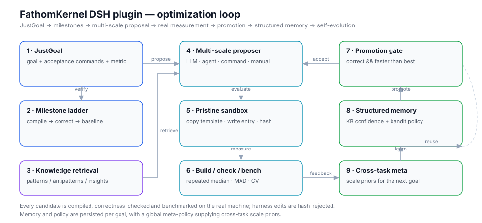
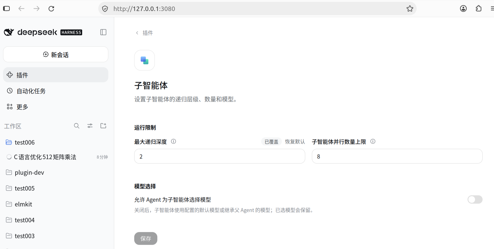
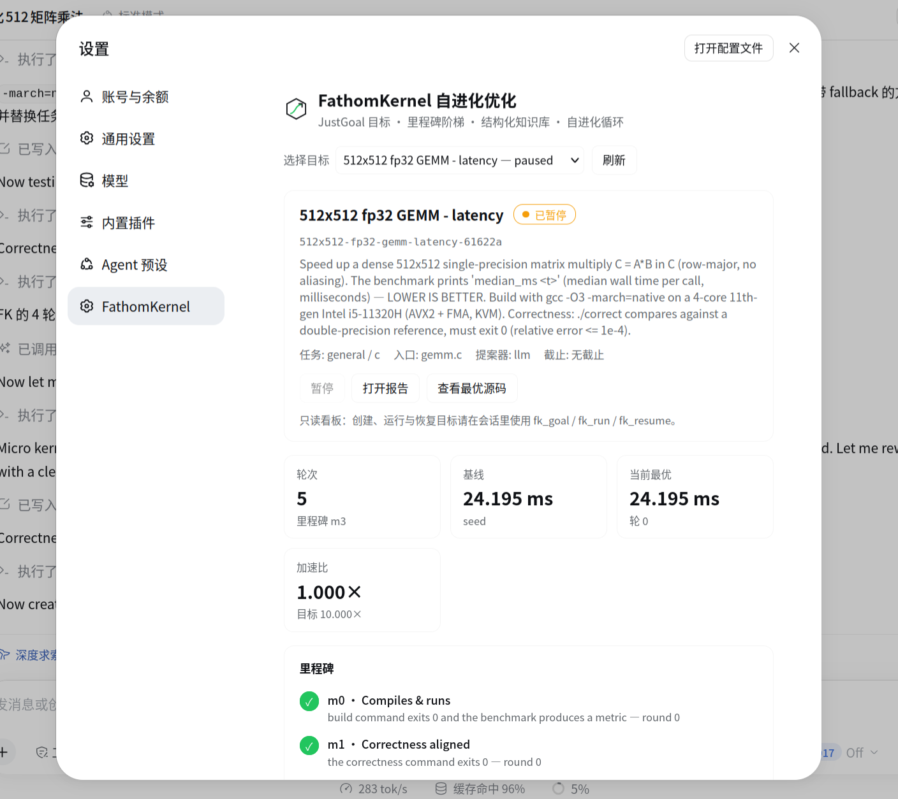
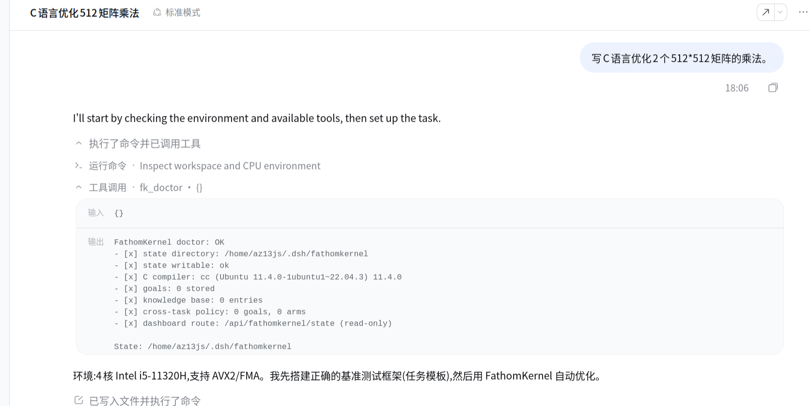
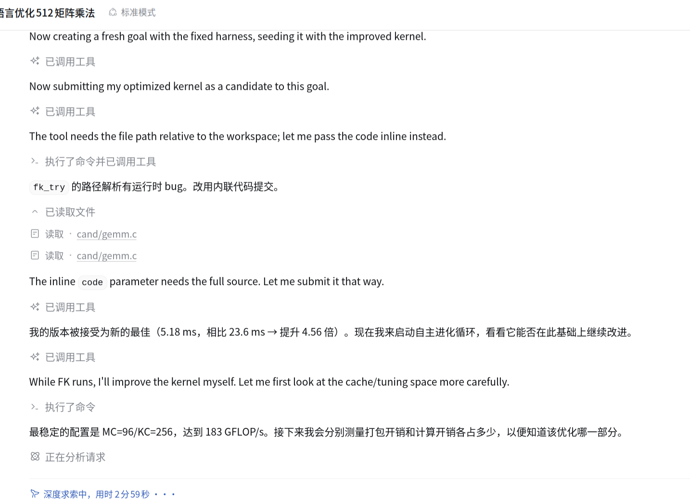

# FathomKernel for DeepSeek Harness

**English** · [简体中文](README.zh.md)

> **Note: this document was generated by AI and has not been carefully reviewed
> by a human.** Where it disagrees with the code or observed behaviour, trust the
> code. Corrections are welcome.

A self-evolving algorithm optimizer plugin for DeepSeek Harness.

You tell it **what to optimize** and **how to tell it is right**. It then revises
the implementation round after round, really compiles it, really measures it, and
keeps only what is actually faster. How to get there is its problem — you do not
need to understand it.



> The mechanisms implemented here — JustGoal, the milestone ladder, multi-scale
> mutation, structured memory, cross-task self-evolution — are a
> **re-implementation written from published descriptions of ForgeKernel**. No
> upstream source code is included; every line in this package is new. What
> differs is the target: this plugin optimizes **general algorithms**, all you
> need to give it is a build, a correctness and a benchmark command. It is not
> limited to GPU kernels.

---

## Contents

- [Install and uninstall](#install-and-uninstall)
- [Three steps](#three-steps)
- [What it actually does](#what-it-actually-does)
- [Where files go](#where-files-go)
- [Configuration](#configuration)
- [Dashboard](#dashboard)
- [Why the numbers are trustworthy](#why-the-numbers-are-trustworthy)
- [When not to use it](#when-not-to-use-it)
- [Reference: the tools](#reference-the-tools)
- [License](#license)

---

## Install and uninstall

On a development machine, use the `dsh plugin` command directly.

**Prerequisite**: `pnpm` must be installed.

**Install**:

```bash
dsh plugin --profile web add <plugin directory>
```

`<plugin directory>` is the directory that contains `package.json`. After cloning
it is called `dsh-fathomkernel`. A relative path works, but it **must start with
`./` or `../`**.

The path may carry a `file:` or `link:` prefix:

```bash
dsh plugin --profile web add ./dsh-fathomkernel
dsh plugin --profile web add file:./dsh-fathomkernel
dsh plugin --profile web add link:./dsh-fathomkernel
```

- `file:` — **copies** the source into `node_modules`; code changes need a
  reinstall to take effect;
- `link:` — creates a **symlink** to the source directory; code changes take
  effect after a Host restart;
- with no prefix, **`link:` is assumed**.

For development the default `link:` is the least friction. When the change is in
the page half (`client.js`), refreshing the page is enough — no restart.

> **To let the plugin hand files back, allow recursion first.** With an `agent`
> proposer the plugin delegates to a subagent that explores and returns code. If
> the Host's *subagents → maximum recursion depth* is `0` (disabled) or `1`
> (main Agent only), the delegation is refused and that round fails outright. Go
> to **Settings → Plugins → Subagents → Run limits** and set **maximum recursion
> depth to `2`**, then save:
>
> 
>
> The parallel subagent limit can follow the core count; `8` is ample on a 4-core
> machine.

After installing, **restart the Host**, then **refresh the browser page** to load
the page half. A **FathomKernel** section appears in the Settings sidebar:



The panel holds the goal selector, pause/resume, open report, view best source,
and the round count, baseline, current best, speedup and milestone verdict. It is
**deliberately read-mostly**: creating, running and resuming happen in the
conversation; the only action the page offers is pause.

### Uninstall

When you are actually done with it:

```bash
dsh plugin --profile web remove @local/dsh-fathomkernel
```

The knowledge base and goals under `~/.dsh/fathomkernel` are a separate directory;
uninstalling does not delete them. Remove that directory yourself to wipe
everything.

---

## Three steps

All of it is done by talking. What follows is one real session.

### Step 1: say what you want



Open a session and just say it — the screenshot shows "write C to optimize
multiplying two 512×512 matrices". Once you have said it, let go: the Agent
inspects the environment, runs `fk_doctor` to confirm the plugin is ready, builds
the **baseline implementation + correctness command + benchmark command**, puts
them under `task/` in the session working directory, and creates the goal.

The plugin looks in exactly one place, `<session working directory>/task/`, and
the directory name is fixed. Usually you need not touch it — but it is worth a
glance, because **the plugin only measures; it does not judge whether the
benchmark is any good**:

| What to check | What counts as wrong |
|---|---|
| **The baseline is really slow and really correct** | A baseline that is already fast means the task was chosen badly; a baseline that is wrong makes everything after it wasted effort |
| **The check really checks** | Only one or two tiny inputs, or comparing lengths only — a broken implementation passes |
| **The benchmark really measures** | A timer too short (a few microseconds), no warm-up, or the result never actually used — what you get is noise or an idle loop |

C, Python, Rust or your own build script all work — just swap the three commands
for the equivalent ones.

### Step 2: let it run

> Start it, and tell me when it is done.

The Agent calls `fk_run`, which starts in the background and returns immediately.
Every round after that is a complete lap: pick a kind of change → look up past
experience → propose a new version → **really compile, really check, measure
repeatedly and take the median** → replace the current best only when it is correct
*and* measurably faster.

Progress reads off this ladder; reaching **m4** means the goal is met and `m5` means
it is still pushing further:

```text
m0 compiles → m1 correct → m2 baseline → m3 meaningful gain → m4 target → m5 beyond target
```

### Step 3: look at the result



This is the rest of that same session: the Agent wrote a fast version itself and
submitted it, the plugin really compiled, really checked and really measured it,
**accepting 5.18 ms against a 23.6 ms baseline (4.56×)** as the new best, and then
started the autonomous loop to keep going. You do none of this by hand — ask about
progress any time, say stop to stop.

---

## What it actually does

Every round is a complete lap, and no step in it is "close enough":

1. **Pick a kind of change** — a small tweak, or replacing the algorithm outright;
2. **Look up experience** — retrieve past conclusions relevant to this task;
3. **Propose** one complete new version;
4. **Really compile, really check, measure repeatedly**, take the median, and
   record the spread alongside it;
5. **Replace** the current best only when the candidate is **correct** *and*
   **measurably faster** than it;
6. **Record** the round's outcome in the knowledge base.

The payoff is that **the second task is cheaper than the first**. Every round
settles into reusable experience, and a new task inherits what has already been
shown to work on this machine. Experience is stored per user, not per workspace,
so every goal you create in any session shares the same store.

---

## Where files go

### State directory

Default is `$DSH_HOME/fathomkernel`, usually `~/.dsh/fathomkernel`. It holds the
knowledge base, the policies and similar data, and **accumulates over time** —
deleting it wipes every piece of experience.

```text
~/.dsh/fathomkernel/
├── knowledge.json             experience base, shared by every goal
├── meta-policy.json           cross-task scale priors
├── index.json                 summary cache, rebuilt on every activation
└── goals/<id>/
    ├── goal.json              this goal's authoritative state
    ├── policy.json            this goal's policy
    ├── rounds.jsonl           one immutable record per round
    ├── events.jsonl           milestone, run and knowledge events
    ├── candidates/            the code snapshot of each round
    └── work/                  throw-away evaluation sandboxes
```

### Custom task

Task material lives in **`task/` inside the session working directory**. The
directory name is fixed and the plugin looks nowhere else; without it, creating a
goal fails outright.

### Deliverables

The report and the best source are written to the **session working directory**,
and only when the Agent asks for them (or when the goal completes):

```text
<session working directory>/fathomkernel-report.md    full Markdown report
<session working directory>/forge-best.<ext>          the best source
```

---

## Configuration

The plugin has **no configuration file of its own**. Configuration lives in the
DSH bundle patch. The default is:

```yaml
- insert:
    - id: fathomkernel
      name: '@local/dsh-fathomkernel'
      config:
        maxKnowledgeEntries: 800
        resumeRunners: false
```

Available keys:

| Key | Default | Meaning |
|---|---|---|
| `stateDir` | `$DSH_HOME/fathomkernel` → `~/.dsh/fathomkernel` | State directory, accumulates over time |
| `maxKnowledgeEntries` | `800` | Once the knowledge base exceeds this, old knowledge is evicted roughly by age |
| `resumeRunners` | `false` | After an abnormal Host restart, carry the goal that was still `running` through to the end; when several goals are left running, only one is adopted |
| `outputExtensions` | built-in table | Overrides the extension of candidate **snapshots**, see below |

A misspelled key makes the plugin refuse to start instead of being silently
ignored.

The goal working directory has **no** configuration override: it always follows
the session working directory, so a goal lands next to the code it is about.

### Does another language need a different `outputExtensions`?

**In most cases, no.** It only decides what suffix the code **snapshots** under
`goals/<id>/candidates/` are stored with; it does not affect the code that gets
compiled and measured — a candidate is always written to the original file named
by `spec.entry`, so if you wrote `kernel.py`, `kernel.py` is what gets measured.

The built-in table already covers the common languages:

| `spec.language` | Snapshot suffix |
|---|---|
| `c` | `c` |
| `cpp` / `c++` / `sycl` | `cpp` |
| `cuda` | `cu` |
| `opencl` | `cl` |
| `python` / `py` / `triton` / `tilelang` / `cupy` | `py` |
| `javascript` / `js` | `mjs` |
| `typescript` / `ts` | `ts` |
| `rust` | `rs` |
| `go` | `go` |
| `java` | `java` |
| anything else | `txt` |

Two cases are worth changing:

- **The language is not in the table.** For `spec.language=zig`, for example,
  every snapshot is stored as `.txt`. It still works, but code in the snapshots
  is easy to misread.
- **The language is in the table but the suffix does not suit you.** The most
  common case is JavaScript: the built-in table gives `mjs`, while a CommonJS
  task (`require`) wants something else. The `javascript: cjs` entry shipped in
  this repository's patch does exactly that, and it applies to **every** JS goal.

To change it, write it in the bundle patch, keyed by `spec.language`:

```yaml
outputExtensions:
  javascript: cjs
  zig: zig
```

When nothing needs changing, leave the key out.

---

## Dashboard

The **FathomKernel** section in Settings is the dashboard for this loop — the
screenshot after the install steps above is exactly it:

- a goal selector;
- the milestone ladder (which rung it reached);
- the measured performance curve (what each improvement looked like);
- the round ledger (what changed each round, and the result);
- the current self-evolution policy;
- a browsable knowledge base.

The dashboard is **deliberately read-mostly**. The engine owns the loop; the page
only presents the facts that were measured. Its only clickable action is "pause" —
creating, running, resuming and writing knowledge all happen through the tools in
the conversation.

---

## Why the numbers are trustworthy

This is the most essential difference between this plugin and "ask a model for a
faster version":

- **Every round starts from a pristine copy** — nothing carries over from the
  previous round, so a candidate cannot cheat by accumulating state.
- **Harness files are protected** — task files are fingerprinted when the goal is
  created and re-checked after every round. A candidate that quietly edits the
  benchmark is rejected, however good the number looks.
- **Repeated measurement** — the median of several processes, with the spread
  (MAD and coefficient of variation) reported rather than hidden.
- **Noise floor** — an improvement smaller than the threshold does not count.
- **Correctness is a gate, not a report** — an incorrect version is never adopted
  no matter how good its numbers.
- **Thorough cleanup** — every child process gets its own process group, and the
  whole group is killed on timeout, leaving no orphans.

> **Security boundary**: this is a **local optimization sandbox, not an
> isolation environment against hostile code**. Candidates run with your user
> permissions. If the task touches sensitive data, isolate it in a container or
> under a dedicated account.

---

## When not to use it

- **Single machine only.** It measures real wall-clock time on this host; there is
  no distributed benchmarking.
- **No isolation against hostile code** (see above).
- **The result is bounded by model capability.** When you submit candidates by
  hand or through an external program, the outcome is only as good as what goes
  in.
- **A busy machine disturbs measurement.** Only relative improvements count, but
  absolute numbers will drift.
- **Goals do not queue.** Several goals run independently and share only the
  knowledge base.

---

## Reference: the tools

You do not normally call these — talking to the Agent is enough and it will call
them for you. They are listed so you can name them in a conversation.

| Tool | Purpose |
|---|---|
| `fk_goal` | Create, list, inspect or update a goal |
| `fk_run` | Start autonomous rounds |
| `fk_status` | Milestone ladder, best candidate, policy, recent rounds |
| `fk_stop` | Pause; history and the best result survive |
| `fk_resume` | Resume a paused goal |
| `fk_try` | Submit a candidate you wrote by hand through exactly the same evaluation |
| `fk_knowledge` | Query or extend the knowledge base |
| `fk_doctor` | Health check: state directory, compiler, goals, memory |

---

## License

MIT — see [LICENSE](LICENSE).

This package has no runtime dependencies and contains no third-party source, so
MIT covers the whole tree. The mechanisms named above are **re-implemented** from
published descriptions — ideas and methods, not code. Nothing from the upstream
project is redistributed here, so its own license does not attach to this
repository.
