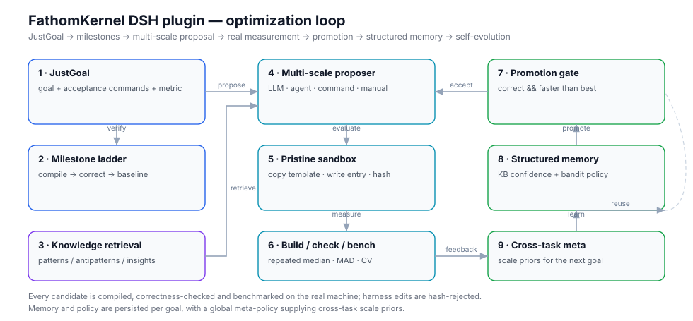

# FathomKernel for DeepSeek Harness

[English](README.md) · **简体中文**

> **说明：本文档由 AI 生成，未经人工仔细审核。** 发现错误请以代码和实际行为为准，并欢迎指出。

一个给 DeepSeek Harness 用的自进化算法优化插件。

你告诉它**要优化什么**、**怎么算做对了**，它自己一轮轮地改、真的编译、真的测速，只留确实更快的那个。怎么优化是它的事，你不需要懂。



> 这里实现的机制——JustGoal、里程碑阶梯、多尺度变异、结构化记忆、跨任务自进化——是**依据 ForgeKernel 的公开描述重新实现**的。本包不含上游源码，每一行都是新写的。区别在目标对象：本插件优化的是**通用算法**，只要能给出构建、校验、测速三条命令就行，不限于 GPU kernel。

---

## 目录

- [安装与卸载](#安装与卸载)
- [三步开始](#三步开始)
- [它到底在做什么](#它到底在做什么)
- [文件放在哪](#文件放在哪)
- [配置](#配置)
- [控制台](#控制台)
- [结果为什么可信](#结果为什么可信)
- [不适用的场景](#不适用的场景)
- [查手册：工具一览](#查手册工具一览)
- [许可](#许可)

---

## 安装与卸载

在开发机器上直接用 `dsh plugin` 命令。

**前提**：机器上得有 `pnpm`。

**安装**：

```bash
dsh plugin --profile web add <插件所在目录>
```

`<插件所在目录>` 是含有 `package.json` 的那个目录。可以写相对路径，但**必须以 `./` 或 `../` 开头**。

安装时路径前面可以带 `file:` 或 `link:` 前缀：

```bash
dsh plugin --profile web add ./fathomkernel-plugin
dsh plugin --profile web add file:./fathomkernel-plugin
dsh plugin --profile web add link:./fathomkernel-plugin
```

- `file:` —— 把源码**复制**一份到 `node_modules`，改了代码要重新安装才生效；
- `link:` —— 用**符号链接**指向源码目录，改了代码重启 Host 就生效；
- 不带前缀时**默认按 `link:` 处理**。

开发时用默认的 `link:` 最省事。改的是界面部分（`client.js`）时，刷新页面就够，不用重启。

**卸载**：

```bash
dsh plugin --profile web remove @local/dsh-fathomkernel
```

装完**重启 Host**，再**刷新浏览器页面**加载界面部分。设置里会出现一个 **FathomKernel** 分区。

---

## 三步开始

### 第一步：准备任务目录

插件只认一个固定的目录名：**会话工作目录下的 `task/`**，也就是 `<会话工作目录>/task/`。所有任务文件都放这里。

**这一步可以交给 Agent 做。** 你直接说「我要优化 X」，Agent 会自己建 `task/`、写一份能跑但很慢的基线实现、配一条校验和一条测速，然后建 goal。下面三个文件是它该写出来的样子——你照着看一眼，就知道它写对了没有。

```text
demo/
└── task/
    ├── kernel.js      ← 要被优化的实现
    ├── check.js       ← 校验：正确就退出码 0
    └── bench.js       ← 测速：打印指标
```

`kernel.js` —— 先写一个**直白、正确、不快**的版本。它就是基线：

```js
function sumSquares(values) {
  let total = 0
  for (let index = 0; index < values.length; index += 1) {
    total += values[index] * values[index]
  }
  return total
}
module.exports = { sumSquares }
```

`check.js` —— 正确就退出码 0：

```js
const { sumSquares } = require('./kernel.js')
if (sumSquares([1, 2, 3, 4, 5]) !== 55) process.exit(1)
```

`bench.js` —— 测速，**最后一行**打印一个 JSON：

```js
const { sumSquares } = require('./kernel.js')
const values = new Float64Array(1 << 20).fill(1.5)
sumSquares(values)
const started = process.hrtime.bigint()
for (let round = 0; round < 20; round += 1) sumSquares(values)
const ms = Number(process.hrtime.bigint() - started) / 1e6 / 20
console.log(JSON.stringify({ latency_ms: ms }))
```

> 换成 C、Python、Rust 或者你自己的构建脚本都行——把三条命令换成对应的命令即可。

#### 让 Agent 代劳时，看一眼这三样

插件只负责**测**，不负责判断你给的基准好不好。交给 Agent 写的话，值得扫一眼：

| 看什么 | 怎么算不对 |
|---|---|
| **基线真的慢、真的对** | 基线本身很快，说明任务选错了；基线不正确，后面全是白努力 |
| **校验真的在验** | 只测一两个小输入，或者只比较长度——错误实现也能过 |
| **测速真的在测** | 计时太短（几微秒）、没有预热、或者结果根本没被用上，测出来的是噪声或空转 |

### 第二步：告诉 Agent 要优化什么

在 `demo/` 的上一级开会话，直接说话：

> 用 FathomKernel 优化 demo 里的平方和，目标是快一倍。

Agent 会去调 `fk_goal` 把这些填进去：

```text
fk_goal action=create
  name="平方和"
  workdir=demo
  spec.language=javascript
  spec.entry=kernel.js
  spec.correctness="node check.js"
  spec.benchmark="node bench.js"
  spec.metric={"name":"latency_ms","path":"latency_ms","unit":"ms"}
  spec.target={"kind":"speedup","value":2}
```

创建时它会立刻跑一遍基线并记下来：

```text
Milestone ladder: m0 → m1 → m2 → m3 → m4 → m5
Baseline: 1.817 ms
```

`target` 里的 `2` 表示目标是**快一倍**。这些参数不用你手填，但知道有这么回事，和 Agent 说话时能说得更准。

### 第三步：让它开跑

> 开始跑吧，跑完告诉我。

Agent 调 `fk_run`，后台开跑并立刻返回。想看进度就问一句，Agent 用 `fk_status` 给你看阶梯爬到哪一级、当前最快多少。想停就说停。

进度看这条阶梯：

```text
m0 编译 → m1 正确 → m2 基线 → m3 有效增益 → m4 达标 → m5 超越目标
```

看到 **m4** 就说明你设的目标达成了。`m5` 表示它还在继续往前推。

---

## 它到底在做什么

每一轮都是完整的一圈，没有哪一步是「大概就行」：

1. **挑一种改法**——小修小补，还是整个换掉算法；
2. **翻经验**——检索这个任务相关的历史结论；
3. **提出**一个完整的新版本；
4. **真的编译、真的校验、反复测速**，取中位数，同时记录波动幅度；
5. 只有**正确**且**比当前最快明显更快**，才**替换**当前最快；
6. 把这一轮的结果**记进经验库**。

好处是**第二个任务比第一个便宜**。每轮结果都沉淀成可复用的经验，新任务直接继承这台机器上已经证明有效的做法。经验按用户存、不按工作区存，所以你在任何会话里开的 goal 都共享同一份。

---

## 文件放在哪

### 状态目录

默认是 `$DSH_HOME/fathomkernel`，一般是 `~/.dsh/fathomkernel`。保存知识库、策略等信息，**长期累积**——删了就等于把所有经验清零。

```text
~/.dsh/fathomkernel/
├── knowledge.json             经验库，所有 goal 共享
├── meta-policy.json           跨任务策略先验
├── index.json                 摘要缓存，每次激活重建
└── goals/<id>/
    ├── goal.json              该 goal 的权威状态
    ├── policy.json            该 goal 的策略
    ├── rounds.jsonl           每轮一条不可变记录
    ├── events.jsonl           里程碑、运行与知识事件
    ├── candidates/            每轮的代码快照
    └── work/                  用完即弃的评测沙箱
```

### 自定义任务

任务素材放在**会话工作目录的 `task/`** 里。目录名固定，插件只在这里找；没有这个目录，建 goal 会直接失败。

### 产物

报告和最优源码生成在**会话工作目录**，需要 Agent 调用（或目标完成时）才生成：

```text
<会话工作目录>/fathomkernel-report.md    完整 Markdown 报告
<会话工作目录>/forge-best.<扩展名>       最优源码
```

---

## 配置

插件**没有自己的配置文件**。配置写在 DSH 的 bundle patch 里。默认配置为：

```yaml
- insert:
    - id: fathomkernel
      name: '@local/dsh-fathomkernel'
      config:
        maxKnowledgeEntries: 800
        resumeRunners: false
```

可配置项：

| 键 | 默认 | 含义 |
|---|---|---|
| `stateDir` | `$DSH_HOME/fathomkernel` → `~/.dsh/fathomkernel` | 状态目录，长期累积 |
| `maxKnowledgeEntries` | `800` | 知识库超过这个数时，大致按时间淘汰旧知识 |
| `resumeRunners` | `false` | Host 异常重启后，把那个「上次还处于 running 状态」的目标接着跑完；多个目标同时残留时只接管一个 |
| `outputExtensions` | 内置表 | 覆盖候选**快照**的扩展名，见下 |

拼错的键会让插件拒绝启动，而不是被悄悄忽略。

goal 的工作目录**没有**配置覆盖项：它永远跟随会话工作目录，所以目标总是落在它所讨论的代码旁边。

### 换语言开发要不要改 `outputExtensions`

**多数情况不用改。** 它只决定 `goals/<id>/candidates/` 里那些代码**快照**存成什么后缀，不影响被编译、被测试的代码——候选永远写到 `spec.entry` 指定的那个原文件上，你写 `kernel.py`，测的就是 `kernel.py`。

内置表已经覆盖了常见语言：

| `spec.language` | 快照后缀 |
|---|---|
| `c` | `c` |
| `cpp` / `c++` / `sycl` | `cpp` |
| `cuda` | `cu` |
| `opencl` | `cl` |
| `python` / `py` / `triton` / `tilelang` / `cupy` | `py` |
| `javascript` / `js` | `mjs` |
| `typescript` / `ts` | `ts` |
| `rust` | `rs` |
| `go` | `go` |
| `java` | `java` |
| 其他任何值 | `txt` |

有两种情况值得改：

- **语言不在表里。** 比如 `spec.language=zig`，快照会一律存成 `.txt`。功能正常，但翻快照看代码时容易误判。
- **语言在表里、后缀不合你意。** 最常见的是 JavaScript：内置给 `mjs`，而任务如果是 CommonJS（`require`），快照后缀就对不上。仓库自带的 patch 里那条 `javascript: cjs` 就是干这个的，它对**所有** JS 目标生效。

要改就写在 bundle patch 里，键名与 `spec.language` 一致：

```yaml
outputExtensions:
  javascript: cjs
  zig: zig
```

没有需要时，这一项不写即可。

---

## 控制台

设置里的 **FathomKernel** 分区是这套循环的仪表盘：

- 目标选择器；
- 里程碑阶梯（走到哪一级）；
- 实测性能曲线（每一次提升的样子）；
- 轮次账本（每轮改了什么，结果如何）；
- 当前的自进化策略；
- 可浏览的经验库。

控制台**刻意做成以展示为主**。循环由引擎负责，页面只呈现测到的事实。唯一能点的动作是「停止」——创建、运行、恢复、写经验都走对话里的工具。

---

## 结果为什么可信

这是本插件和「让模型随便写个更快的版本」最本质的区别：

- **每轮从干净副本开始**——上一轮的东西不会漏到下一轮，候选无法靠累积状态作弊。
- **基准文件受保护**——任务文件在建 goal 时记了指纹，每轮之后复查。候选偷偷改测速代码？直接驳回，哪怕数字好看。
- **重复测量**——多个进程取中位数，并把波动幅度（MAD、变异系数）一起报出来，而不是藏起来。
- **噪声下限**——提升小于阈值的，不算改进。
- **正确性是闸门，不是报告**——不正确的版本永远不会被采纳，数字再漂亮也没用。
- **彻底清理**——每个子进程单独成组，超时整组杀掉，不留孤儿进程。

> **安全边界**：这是一个**本地优化沙箱，不是防恶意代码的隔离环境**。候选以你的用户权限运行。如果任务涉及敏感数据，请用容器或专用账号隔离。

---

## 不适用的场景

- **只适合单机。** 测的是本机真实耗时，不支持分布式压测。
- **没有防恶意代码的隔离**（见上）。
- **结果受模型能力限制。** 用人工或外部程序提交候选时，好坏取决于喂进去的东西。
- **机器忙会干扰测量。** 只按相对提升判定，绝对数字会浮动。
- **目标之间不排队。** 多个 goal 各跑各的，只共享经验库。

---

## 查手册：工具一览

日常不需要直接调这些——跟 Agent 说话就够了，它会替你调。这里列出是为了让你在对话里能点出名字。

| 工具 | 作用 |
|---|---|
| `fk_goal` | 创建 / 列出 / 查看 / 更新 goal |
| `fk_run` | 开始自主轮次 |
| `fk_status` | 里程碑阶梯、最优候选、策略、最近轮次 |
| `fk_stop` | 暂停，历史和最优结果都保留 |
| `fk_resume` | 恢复暂停的 goal |
| `fk_try` | 提交一个你手写的候选，走完全相同的评测流程 |
| `fk_knowledge` | 查询或补充经验库 |
| `fk_doctor` | 健康检查：状态目录、编译器、目标、记忆 |

---

## 许可

MIT —— 见 [LICENSE](LICENSE)。

本包没有运行时依赖，也不含第三方源码，因此整棵树的 MIT 覆盖是完整的。上文提到的各项机制是依据公开描述**重新实现**的——属于思想与方法，不是代码。这里没有分发上游项目的任何内容，因此其自身的许可证不附着于本仓库。

